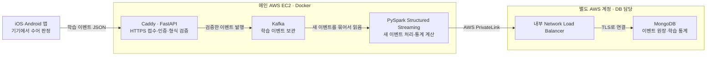
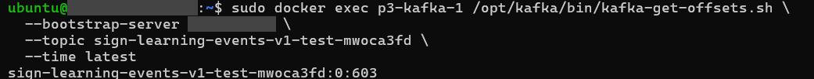
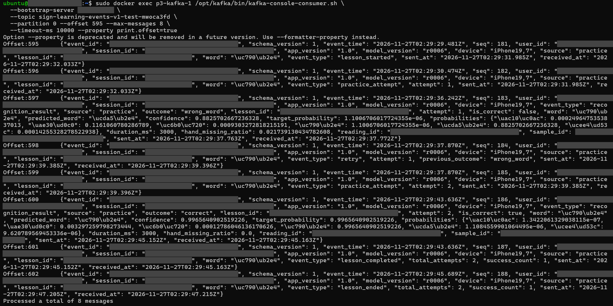

# 메인 AWS 서버 구성과 학습 이벤트 처리

사용자가 앱에서 `커피`를 따라 하면, 기기의 모델이 동작을 판정하고 앱이 연습 시도와 인식 결과를 학습 이벤트로 보낸다. 메인 서버는 학습 시작·연습 시도·인식 결과·재시도·학습 종료 같은 기록을 받아 검증하고, 이후 조회할 수 있도록 이벤트 원문과 학습 통계를 MongoDB에 저장한다.

실제 iOS·Android 기기가 같은 HTTPS 주소로 접속하고 팀원이 같은 환경에서 연동을 검증할 수 있도록 서울 리전의 AWS EC2(`t3.medium`, Ubuntu 24.04)를 사용했다. 시연 규모에 맞춰 Caddy·FastAPI·Kafka·Spark를 EC2 한 대에 Docker Compose로 배포했다. Elastic IP로 앱 접속 주소를 고정했고, Caddy의 HTTPS 인증서와 컨테이너 자동 재시작 정책을 적용했다. 별도 AWS 계정의 MongoDB는 PrivateLink와 내부 Network Load Balancer를 통해 연결하며 TLS(CA 인증서 검증)와 사용자 인증을 사용한다.

## 학습 이벤트가 저장되기까지

1. **FastAPI가 학습 이벤트를 받는다.** Caddy가 HTTPS 요청을 `POST /v1/events`로 전달한다. FastAPI는 `X-API-Key`와 이벤트별 JSON 필드를 검증하고, 한 요청에 최대 100개 이벤트와 본문 1 MB를 허용한다.
2. **Kafka가 이벤트를 보관한다.** Python의 `aiokafka`로 Apache Kafka 4.4.0에 이벤트를 한 건씩 JSON으로 발행한다. 메시지 키는 `user_id`이며, 토픽·파티션·오프셋으로 레코드 위치를 추적한다. 모든 발행을 확인하면 앱에 HTTP `202`를 반환한다. MongoDB 저장은 뒤이어 Spark가 처리한다.
3. **PySpark가 새 기록을 계속 처리한다.** Apache Spark 4.2.1의 PySpark API와 Kafka 커넥터로 Structured Streaming을 구현했다. `readStream`으로 현재 앱 토픽의 파티션 0을 읽고, `foreachBatch`로 새 이벤트를 묶어서 처리한다. 처리 시작 간격은 5초로 설정했고, 한 배치에서 최대 100개 Kafka 오프셋을 읽는다.
4. **MongoDB에 원문과 집계 결과를 저장한다.** Spark는 JSON을 스키마로 파싱해 `event_id`와 `event_time`을 확인한다. 이벤트 원문은 `event_id`를 키로 저장하며, 같은 ID가 다시 들어오면 기존 문서를 유지한다. 각 배치에서는 해당 토픽의 원장을 읽어 **1분 단어별 연습 횟수, 최근 5분 미인식 비율, 사용자 확인 일치율**을 계산하고 별도 컬렉션에 저장한다. 체크포인트에 처리 위치를 기록해 작업 재시작 시 이어서 읽을 수 있다.

## 처리 상태 확인과 누락 복구

| 확인 항목 | 확인 방법 |
| --- | --- |
| 미처리 구간 | 같은 파티션에서 Kafka의 다음 오프셋과 Spark 체크포인트의 다음 오프셋을 비교한다. |
| 누락 | 처리 대상 Kafka 이벤트의 `event_id`를 MongoDB 원장과 대조한다. |
| 중복 | Kafka의 동일 ID 재전송 여부와 MongoDB에 해당 ID의 문서가 한 건만 유지되는지 확인한다. |
| 오류 | FastAPI의 HTTP 응답과 Kafka 발행·Spark 처리·MongoDB 쓰기 결과를 단계별로 확인한다. HTTP 요청 실패 수와 그 요청에 담긴 이벤트 수를 구분한다. |

오프셋 `504~560`의 실제 아이폰 이벤트 **57건**이 상시 Spark를 거쳐 MongoDB에 자동 저장됐고, 두 저장소의 `event_id`, 오프셋, JSON 원문이 일치했다.

### Kafka 수신 확인

11월 27일 아이폰에서 학습 기록을 보낸 뒤, Kafka의 파티션 0에서 다음 오프셋이 **`603`**인 것을 확인했다.

이전 확인 위치인 `595`부터 다시 읽어 **`595~602`의 이벤트 8건**을 확인했다. 학습 시작, 연습 시도, 인식 결과, 재시도, 학습 완료와 종료가 각각 메시지로 저장됐다.

공개용 이미지는 원본 터미널 캡처에서 내부 접속 주소와 사용자·세션·이벤트 등의 ID 값만 가렸다. 오프셋 `597`에서는 첫 시도의 인식 결과가 `wrong_word`이고 `is_correct`가 `false`인 것을, 오프셋 `600`에서는 두 번째 시도의 인식 결과가 `correct`이고 `is_correct`가 `true`인 것을 볼 수 있다. 같은 구간의 MongoDB 저장은 아래 복구 도구 미리보기로 대조했다.

### 누락 복구와 미리보기

누락 조사에서는 상시 작업의 시작 오프셋 `441`보다 앞에 있던 **`437~440`의 4건**이 MongoDB 원장에 없는 것을 확인했다. 별도 Spark 배치로 해당 범위만 읽어 MongoDB에 추가했다. 상시 작업과 체크포인트는 유지했고, 기존 24건을 포함해 **28건의 ID·오프셋·원문을 다시 대조**했다. 이 사례처럼 미처리 구간이 없어도 상시 작업의 시작 위치보다 앞선 기록은 별도 대조가 필요하다.

이후 같은 방식을 재사용할 수 있도록 **범용 Spark 복구 도구**를 EC2에 설치했다. 토픽·파티션·시작과 끝 오프셋을 입력하면 Kafka 메시지에서 실제 `event_id`를 읽어 MongoDB에 빠진 건수를 미리 보여 준다. `--apply`를 지정할 때만 없는 이벤트를 기존 원장에 추가하고, 실제 삽입한 ID를 감사 파일에 기록한다. 복구 작업은 지정 범위를 처리한 뒤 종료하며 상시 Spark 체크포인트와 독립적으로 실행된다.

범용 도구의 미리보기는 실제 Kafka 오프셋 **`595~602`**에서 검증했다. **8건 모두 MongoDB에 있었고 누락은 0건**이었다. 누락 삽입과 재실행 시 중복 방지는 로컬 모의 테스트에서 확인했으며, 범용 도구의 실제 DB 쓰기 검증은 후속 작업이다.

## 소스와 배포 설정

아래 경로는 메인 서버 작업 폴더 기준이다. 이 표는 실제 배포 소스를 함께 공개할 때 포함할 파일을 정리한다.

| 확인할 내용 | 파일 |
| --- | --- |
| 학습 이벤트 API와 Kafka 발행 | `api_server/app.py`, `api_server/learning_events.py`, `api_server/kafka_delivery.py` |
| PySpark 상시 스트리밍 | `analytics/stream_learning_metrics.py`, `analytics/verify_learning_metrics.py` |
| 컨테이너 빌드와 설정 예시 | `api_server/Dockerfile`, `api_server/requirements.lock`, `api_server/.dockerignore`, `api_server/.env.example` |
| API·HTTPS 배포 설정 예시 | `api_server/compose.api.yaml`, `api_server/compose.https.yaml`, `api_server/Caddyfile.events` |
| 범용 복구 도구 | `replay.py`, `run.sh`, `prepare.sh` |

현재 로컬 `app.py`를 공개할 경우 의존 파일인 `api_server/sample_storage.py`를 함께 포함한다. 좌표 샘플 API의 실제 S3 저장 검증과 배포는 후속 작업이다.

[서버 담당자 배포 보고](aws-deployment-report.md) · [전체 아키텍처](../docs/architecture.md) · [운영 절차](../docs/operations.md) · [검증 결과](../docs/verification.md)
